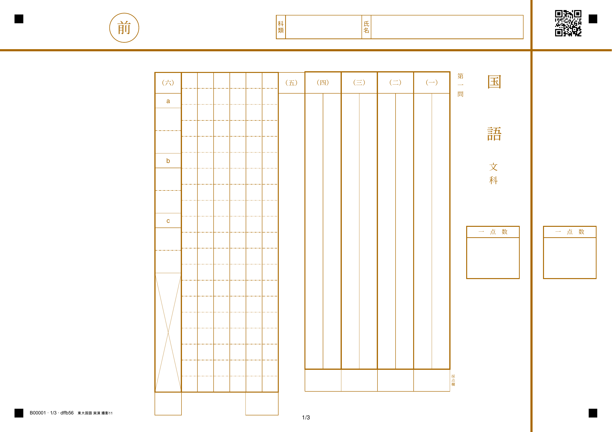
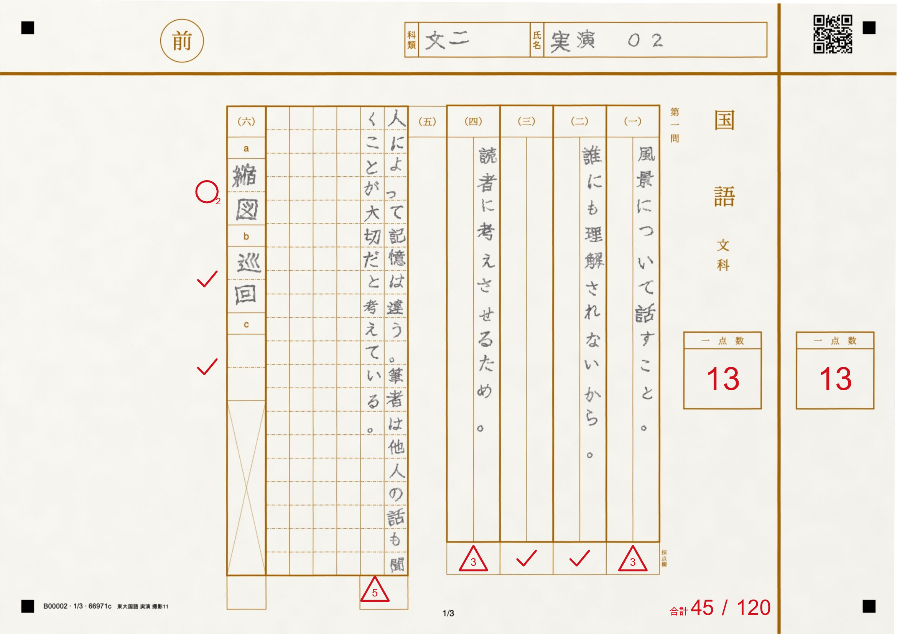
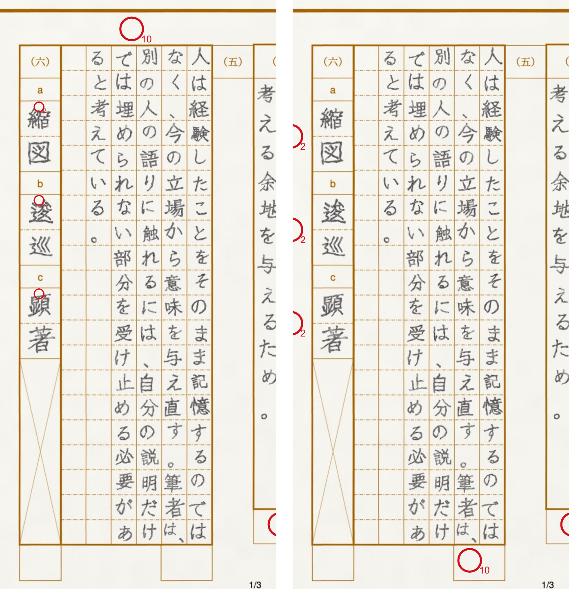

# チャッピーと東大国語の用紙を再現して採点

**非公式**です。東京大学とは関係ありません。

ChatGPT（GPT-6.2 Sol・思考量「軽」）にこのプロンプトを 1 回送ると、[Scoring64](https://scoring64.fermion.company/) で東大国語の形式の解答用紙を組み、2 人分の答案を採点して返却用 PDF まで作ります。見本の用紙・スクリプト・記録は[公開ディレクトリ](https://github.com/KKTeX/Publicated-Files/tree/main/Qiita/チャッピーと東大国語の用紙を再現して採点)にあります。

https://x.com/KKTeX_LaTeX3/status/2125448842112041198



## プロンプト

```text
Scoring64 のプラグイン（make-sheet と grade のスキル）を使って、見本と同じ形の解答用紙を作り、採点までやってみせてください。

見本：作業フォルダの 用紙見本.pdf（3ページ）

1）見本は東大の国語の形式の解答用紙です。これと同じ形の用紙を、白紙の「東大形式」から部品だけで組んでください。A4横、色は茶、3ページです。見本のファイルそのものは取り込まないでください。
   形をそろえるために、次を守ってください。
   ・先に見本PDFの線を座標で読み取り、どの線がどの部品のものかを表にしてから組んでください。位置と大きさはmmの数値で入れ、ドラッグや目測で合わせないでください。
   ・見本にある線だけを引いてください。欄の高さと、採点欄があるか・どう区切られているかは見本のとおりにし、隣の欄とそろえるために変えないでください。採点を行ごと・枠ごとに分けても、見本で採点欄が離れた1つの四角なら、採点欄は「なし」にして、その四角は「枠」で置いてください。
   ・1ページ組むごとに「PDF」表示のPDFを保存し、見本と線の座標を突き合わせてください。片方にしかない線（0.5mm以上ずれた線を含む）がなくなるまで直してから、次のページへ進んでください。
2）配点は、第一問が（一）〜（四）各6点、（五）10点、（六）の漢字が各2点。第二問は（一）のア・イ・カが各2点、（二）〜（五）が各6点。第三問は各6点。第四問は各5点。合計120点です。
3）できたら保存して発行し、2人分の印刷用PDFを作ってください。
4）実演なので答案は手元にありません。それらしい解答を2人分考えて、作業フォルダの 手書き答案.swift で発行したPDFに手書き風に書き込み、スキャンした答案として取り込んでください（使い方はファイルの冒頭、各欄の字数は --fields で確かめられます）。1人は全部書いてある答案、もう1人は空欄や間違いが混じった答案にしてください。氏名は「実演 01」「実演 02」にしてください。できたPDFを開いて、字が欄に収まって読めることを確かめてから取り込んでください。
5）取り込んだ答案を全問採点してください。採点基準は任せます。満点・部分点・0点が混ざるようにしてください。「出力」タブで2人の合計点を確かめたら、ZIPを作り、「プレビュー」で1人分の返却用PDFを開いて見せてください。

Scoring64 の画面は Google Chrome の新しいウインドウで開いて操作してください。Scoring64 の操作は画面だけで行い（データベースや内部APIに直接書き込まない）、TeXの部品は使わないでください。見本PDFの座標の読み取りや答案PDFづくりには、コマンドやスクリプトを使ってかまいません。既存の試験には触らず、新しい試験を1つ作ってその中でやってください。途中で確認は要りません。

終わったら、かかった時間、画面操作のおおよその回数、スキルの説明と実際の画面が違っていた箇所、やり直した箇所を教えてください。
```
前提です。
送る前に、Scoring64（1.3.1 以降）と ChatGPT の Scoring64 プラグイン（0.3.0 以降）を入れ、「設定 › コンピューターの使用」で Google Chrome をオンにします。
新しいフォルダに `用紙見本.pdf` と `手書き答案.swift` を入れ、そのフォルダの新しいプロジェクトで送ります。終わるまで Mac と Chrome には触らないでください。

本物の答案を使うときは、答案の画像が ChatGPT に渡ることには十分ご注意を。



## 追記：直させたプロンプト

流石に東大の用紙は込み入っており、テンプレを使用せず作ったぶんほんの少し意図とずれた部分がありました。なので少し修正プロンプトを入れて手直しもしてみました。

ちなみに、effortをあげて仕舞えば最初から気にならない結果を出せたのですが、修正しているところを見せるという意味でも今回は一番軽量なものをここで提示しています。

（五）の採点記号が欄の外に出ていたことと、1 ページ目の「前」のずれを、同じチャットで直させました。

```text
返却用PDFと用紙を見て、直してほしいところが2つあります。この試験の中で直して、用紙から返却用PDFまで出し直してください。

1）採点記号の位置
実演 01 の返却用PDFの1ページ目で、第一問（五）の採点記号（○と10）が解答欄の外、（五）の列の上の余白に出ています。見本では、（五）の点を書くのは解答欄の下に離して置いた右側の四角です。（五）の記号はこの四角に入れてください。記号の位置は、用紙タブの「返却の見本」か出力タブの「1人分をプレビュー」で、試験全体についてドラッグで動かせます。ほかの問いも、記号が欄の外に出たり、見出しや字に重なったりしていないか全ページ確かめ、同じように直してください（たとえば（六）の記号は a・b・c の字に重なっています）。

2）「前」の位置
用紙1ページ目の上の丸の中の「前」が、丸の中心からずれています（字の中心が丸の中心より約1.5mm上）。2・3ページ目と見本では中心にあります。1ページ目も見本どおりにしてください。線でない部品（字や記号）も、見本と位置を突き合わせてください。

出し直し
直した用紙を発行し直し、2人分の印刷用PDFを作り直してください。答案は直した用紙に前と同じ内容で書き直して取り込み、前と同じ基準で採点し直してください。前の用紙で取り込んだ答案は使わないでください。ZIPを作り、実演 01 の返却用PDFを開いて、2つとも直ったことを確かめてください。できたファイルは作業フォルダの「実演出力_修正後」に保存し、「実演出力」はそのまま残してください。

決まりは前回と同じです（Scoring64 は Chrome の新しいウインドウで画面だけで操作し、ほかの試験には触らない。途中で確認は要りません）。

終わったら、かかった時間、画面操作のおおよその回数、それぞれどう直したか、やり直した箇所を教えてください。
```




大問名の書体など残った差と、2 回の記録は `ChatGPT実行記録.md` にあります。

過去の記事：[受験生用鉄緑風プリント作成プロンプト](https://qiita.com/KKTeX/items/c2612d68b2882afd620a)

