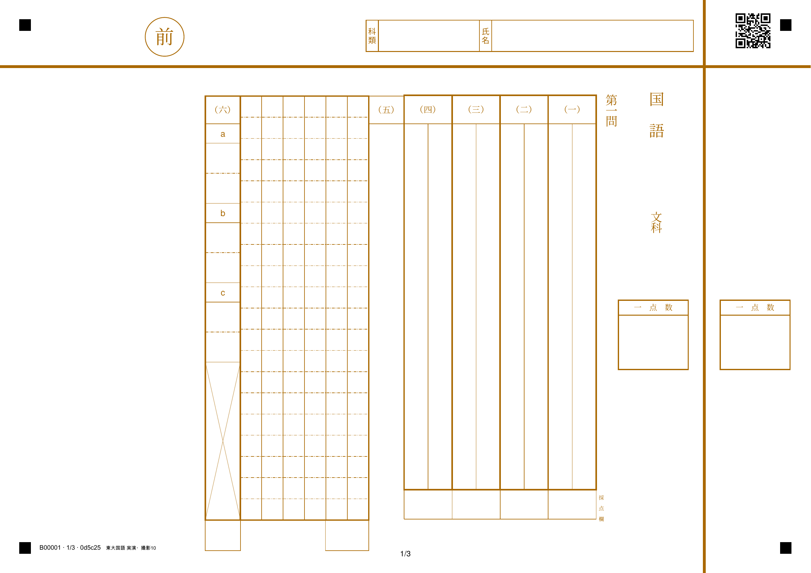
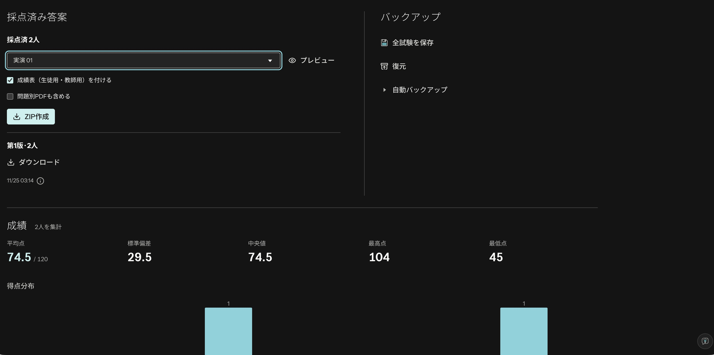
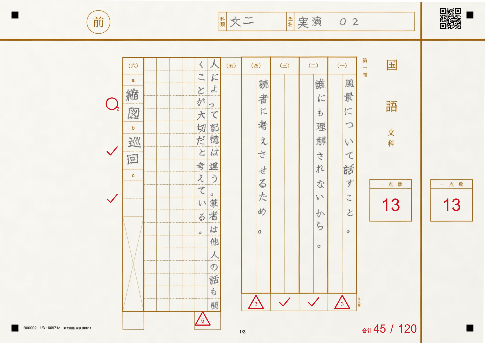
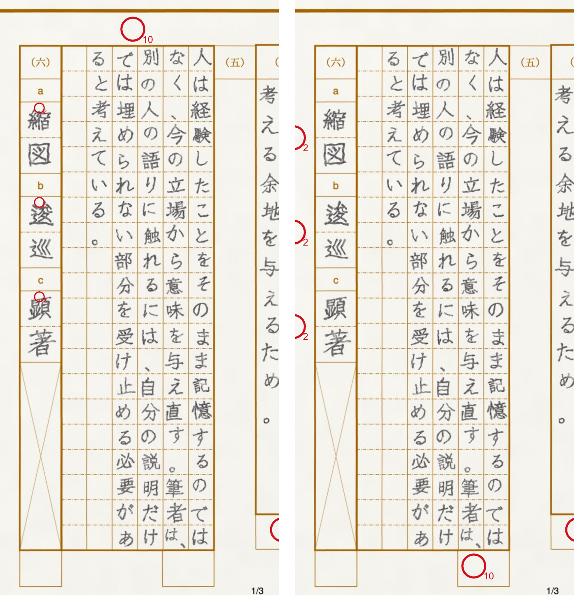

**非公式**です。東京大学とは関係ありません。

## 出力例

ChatGPT（Work、GPT-6.2 Sol・思考量「軽」）が [Scoring64](https://scoring64.fermion.company/) を操作して、白紙から東大国語の形式の解答用紙を組み、2 人分の答案を採点して返却用 PDF を作るまでです。Scoring64 の画面は Chrome の新しいウインドウで操作させています。下のプロンプトを 1 回送ったあとは、何も操作していません。仕上がりを見て直させた 2 回目は、末尾の追記にあります。

プロンプト・見本の用紙・答案づくりのスクリプト・動画は [KKTeX/Publicated-Files の公開ディレクトリ](https://github.com/KKTeX/Publicated-Files/tree/main/Qiita/チャッピーと東大国語の解答用紙の再現作成&採点) にまとめてあります。

<!-- 動画：figures/demo.mp4（X に投稿し、その URL を 1 行で貼って埋め込む） -->



## 使い方

1. Scoring64（1.3.1 以降）を入れる
2. ChatGPT のデスクトップアプリで、プラグイン「Scoring64」（0.3.0 以降）を入れる
3. ChatGPT の「設定 › コンピューターの使用」で「Google Chrome」をオンにする（Chrome に拡張機能が入る）
4. 新しいフォルダを作り、公開ディレクトリの `用紙見本.pdf`（見本の用紙）と `手書き答案.swift`（手書き風の答案を作るスクリプト）を入れる
5. ChatGPT で、そのフォルダをソースにした新しいプロジェクトを作る（前の会話の内容が混ざらないように）。フォルダを信頼するか聞かれたら「フォルダーを信頼する」を押す
6. 「Work」で新しいチャットを開き、モデルを GPT-6.2 Sol・思考量「軽」にして、下のプロンプト全文を貼って送る

権限が「フルアクセス」でも、Scoring64 の画面を開く・PDF を保存する・答案を取り込む、の許可を聞かれることがあります。画面を開くのは「このチャットで許可」、保存と取り込みは「一度だけ許可」を押してください（画面を開くのを拒否すると、Chrome での操作も止まります）。

終わるまで（今回は約 36 分）Mac と Chrome には触らないでください。Chrome の上に出る「ChatGPT がこのブラウザのデバッグを開始しました」の「キャンセル」を押すと、ChatGPT の操作が切れます。Mac のスリープや画面ロックでも止まります。新しいプロジェクトで最初に送ると「Hmm...something seems to have gone wrong.」と出ることがあります。そのときは ChatGPT を終了して開き直し、同じプロジェクトの新しいチャットで送り直してください。

## プロンプト全文

```text
Scoring64 のプラグイン（make-sheet と grade のスキル）を使って、見本と同じ形の解答用紙を作り、採点までやってみせてください。

見本：作業フォルダの 用紙見本.pdf（3ページ）

1）見本は東大の国語の形式の解答用紙です。これと同じ形の用紙を、白紙の「東大形式」から部品だけで組んでください。A4横、色は茶、3ページです。見本のファイルそのものは取り込まないでください。
   形をそろえるために、次を守ってください。
   ・先に見本PDFの線を座標で読み取り、どの線がどの部品のものかを表にしてから組んでください。位置と大きさはmmの数値で入れ、ドラッグや目測で合わせないでください。
   ・見本にある線だけを引いてください。欄の高さと、採点欄があるか・どう区切られているかは見本のとおりにし、隣の欄とそろえるために変えないでください。採点を行ごと・枠ごとに分けても、見本で採点欄が離れた1つの四角なら、採点欄は「なし」にして、その四角は「枠」で置いてください。
   ・1ページ組むごとに「PDF」表示のPDFを保存し、見本と線の座標を突き合わせてください。片方にしかない線（0.5mm以上ずれた線を含む）がなくなるまで直してから、次のページへ進んでください。
2）配点は、第一問が（一）〜（四）各6点、（五）10点、（六）の漢字が各2点。第二問は（一）のア・イ・カが各2点、（二）〜（五）が各6点。第三問は各6点。第四問は各5点。合計120点です。
3）できたら保存して発行し、2人分の印刷用PDFを作ってください。
4）実演なので答案は手元にありません。それらしい解答を2人分考えて、作業フォルダの 手書き答案.swift で発行したPDFに手書き風に書き込み、スキャンした答案として取り込んでください（使い方はファイルの冒頭、各欄の字数は --fields で確かめられます）。1人は全部書いてある答案、もう1人は空欄や間違いが混じった答案にしてください。氏名は「実演 01」「実演 02」にしてください。できたPDFを開いて、字が欄に収まって読めることを確かめてから取り込んでください。
5）取り込んだ答案を全問採点してください。採点基準は任せます。満点・部分点・0点が混ざるようにしてください。「出力」タブで2人の合計点を確かめたら、ZIPを作り、「プレビュー」で1人分の返却用PDFを開いて見せてください。

Scoring64 の画面は Google Chrome の新しいウインドウで開いて操作してください。Scoring64 の操作は画面だけで行い（データベースや内部APIに直接書き込まない）、TeXの部品は使わないでください。見本PDFの座標の読み取りや答案PDFづくりには、コマンドやスクリプトを使ってかまいません。既存の試験には触らず、新しい試験を1つ作ってその中でやってください。途中で確認は要りません。

終わったら、かかった時間、画面操作のおおよその回数、スキルの説明と実際の画面が違っていた箇所、やり直した箇所を教えてください。
```

1）の 3 つの「・」が要です。これがないと、隣の欄と高さをそろえようとして見本にない採点欄を足したり（たとえば（六）の下に細い枠を 3 つ並べる）、ドラッグで置いてずれたりします。ページごとに線の座標を見本と突き合わせるので、形の誤りは次のページへ進む前に直されます。

4）の `手書き答案.swift` は、発行した PDF の各欄に 1 マス 1 字で手書き風の字を置き、スキャンしたような答案 PDF にします。答案が手元にない実演のためのもので、macOS で動きます（使い方はファイルの冒頭）。プロンプトの「Scoring64 の画面は Google Chrome の新しいウインドウで開いて操作してください」を外すと、今の ChatGPT は Scoring64 を画面に出ないブラウザで操作します。結果は同じですが、途中の様子は見えません。

自分の用紙にするときは、見本を自分の PDF に差し替え、1）の「東大の国語」「A4 横、色は茶、3 ページ」と 2）の配点を書き換えます。本物の答案を採点するなら、4）を「答案は作業フォルダの 答案.pdf です」に替え、5）に自分の採点基準を書きます。`手書き答案.swift` は要りません。

2）の配点は東大が公表していません。大問ごとの点は予備校の予想（第一問 40・第二問 30・第三問 30・第四問 20、合計 120 点。文科の国語の満点）に合わせ、小問ごとの点は仮に決めました。

## 使用例

上の手順どおり、空のフォルダと新しいプロジェクトで 1 回送った結果です。

| 項目 | 結果 |
| --- | --- |
| かかった時間 | 約 36 分（GPT-6.2 Sol・軽） |
| 画面操作 | 約 1,000 回（ChatGPT の自己申告） |
| 用紙 | 3 ページ・24 問・120 点。線は 3 ページとも見本と一致（334 区間で、片方にしかない線と 0.5mm 以上のずれが 0 本） |
| 答案 | 2 人分・6 ページ。1 マス 1 字の手書き風。6 ページとも字が欄に収まっていることを確かめてから取り込んだ |
| 採点 | 2 人とも全 24 問を採点。合計 104 点と 45 点（120 点満点） |
| 返却用 PDF | ZIP を作り、「プレビュー」で 1 人分を表示 |
| スキルの説明との違い | 印刷用 PDF と返却用 ZIP は、作ったあと別のリンクから保存する形だった。部分点は数字キーで直接入れられ、10 点の欄では数字キーで入力欄が開き Enter で確定した |
| やり直し | 縦書きの見出しの列の間隔、3 ページ目右の点数欄の幅、ファイル選択画面での移動先の入力。採点中に満点のキーが 1 回反映されず、画面のボタンで採点した |



「出力」タブで 2 人の合計点を確かめ、ZIP を作ったところです。返却用 PDF には採点の印と小計、1 人ずつの成績票が付きます。



## 注意

- 公開ディレクトリの `用紙見本.pdf` は Scoring64 で組んだ非公式の再現で、大学名・年度・ロゴは入れていない。ほかの見本（実物や、他の人が再現して配っているもの）を使うときは自分の勉強用にとどめ、大学名・年度・ロゴは写さない
- 答案と採点基準は実演用に ChatGPT が作ったもの。本番では基準を自分で渡し、付いた点を確かめる
- 答案の画像は ChatGPT に渡る。氏名など個人情報が写った答案はそのまま読ませない
- ChatGPT が Chrome を操作する。ほかのタブやサインイン中のサイトは閉じておく
- Scoring64 の無料プランは月 2 テストまで。用紙の作成と発行は数えない

## 追記：仕上がりを見て直させた

公開前に用紙と返却用 PDF を見直すと、直したいところが 2 つありました。

- 返却用 PDF で、第一問（五）の採点記号（○と 10）が解答欄の外、列の上の余白に出ていた。（五）は、プロンプトの 1）のとおり採点欄を「なし」にして、点を書く四角を「枠」で置いている。採点欄がない問いの記号を、Scoring64 は欄の上の余白に置く
- 用紙 1 ページ目の丸の中の「前」が、丸の中心より約 1.5mm 上にあった（2・3 ページ目と見本は中心）。ページごとの突き合わせは線だけだったので、字の位置のずれは残っていた

動画を撮ったのと同じチャットに、次のプロンプトを続けて送りました。動画は 1 回目だけです。

```text
返却用PDFと用紙を見て、直してほしいところが2つあります。この試験の中で直して、用紙から返却用PDFまで出し直してください。

1）採点記号の位置
実演 01 の返却用PDFの1ページ目で、第一問（五）の採点記号（○と10）が解答欄の外、（五）の列の上の余白に出ています。見本では、（五）の点を書くのは解答欄の下に離して置いた右側の四角です。（五）の記号はこの四角に入れてください。記号の位置は、用紙タブの「返却の見本」か出力タブの「1人分をプレビュー」で、試験全体についてドラッグで動かせます。ほかの問いも、記号が欄の外に出たり、見出しや字に重なったりしていないか全ページ確かめ、同じように直してください（たとえば（六）の記号は a・b・c の字に重なっています）。

2）「前」の位置
用紙1ページ目の上の丸の中の「前」が、丸の中心からずれています（字の中心が丸の中心より約1.5mm上）。2・3ページ目と見本では中心にあります。1ページ目も見本どおりにしてください。線でない部品（字や記号）も、見本と位置を突き合わせてください。

出し直し
直した用紙を発行し直し、2人分の印刷用PDFを作り直してください。答案は直した用紙に前と同じ内容で書き直して取り込み、前と同じ基準で採点し直してください。前の用紙で取り込んだ答案は使わないでください。ZIPを作り、実演 01 の返却用PDFを開いて、2つとも直ったことを確かめてください。できたファイルは作業フォルダの「実演出力_修正後」に保存し、「実演出力」はそのまま残してください。

決まりは前回と同じです（Scoring64 は Chrome の新しいウインドウで画面だけで操作し、ほかの試験には触らない。途中で確認は要りません）。

終わったら、かかった時間、画面操作のおおよその回数、それぞれどう直したか、やり直した箇所を教えてください。
```

| 項目 | 結果 |
| --- | --- |
| かかった時間 | 約 16 分（同じチャット・GPT-6.2 Sol・軽） |
| 画面操作 | 約 880 回（ChatGPT の自己申告） |
| 「前」 | 1 ページ目の字を 1.4mm 下げ、3 ページとも丸の中心にそろえた。大問名や「採点欄」の字の位置も、座標で見本に合わせた |
| 採点記号 | （五）の記号を、下の右側の四角へ移した。（六）の a・b・c の記号は左下の小さな枠に 3 つ並ばないので、それぞれの答えの左の余白へ移した。記号の位置は試験全体で決まるので、2 人とも同じ位置になる |
| 出し直し | 用紙を第 2 版として発行し、同じ解答を書き直した答案を取り込んで採点し直した。点は 1 回目と同じ 104 点と 45 点。1 回目の答案は取り込みの対象から外した（ZIP の成績 CSV には「未提出」の行で残る） |
| やり直し | ドラッグで動かした記号の位置が、画面を開き直すと戻った（矢印キーで入れ直した）。（六）の記号を最初は大問の小計の枠に置き、小計の数字と重なったので、答えの左へ移して ZIP を作り直した |
| 残った差 | 大問名（「第一問」など）と「文科」は、見本が太いゴシック、作った用紙が細い明朝。2 ページ目の小問番号（第二問の（二）〜（五）など）は字が見本より大きく（6.5pt と 9pt）、括弧の位置が約 0.9mm ずれる。「科類」「氏名」もわずかに大きい（8pt と 8.1pt） |




記事中の用紙と返却用 PDF の画像は、直したあとのものです。2 回のプロンプトと、使ったモデル・アプリのバージョンは、公開ディレクトリの `ChatGPT実行記録.md` にまとめました。

過去の記事：[受験生用鉄緑風プリント作成プロンプト](https://qiita.com/KKTeX/items/c2612d68b2882afd620a)
